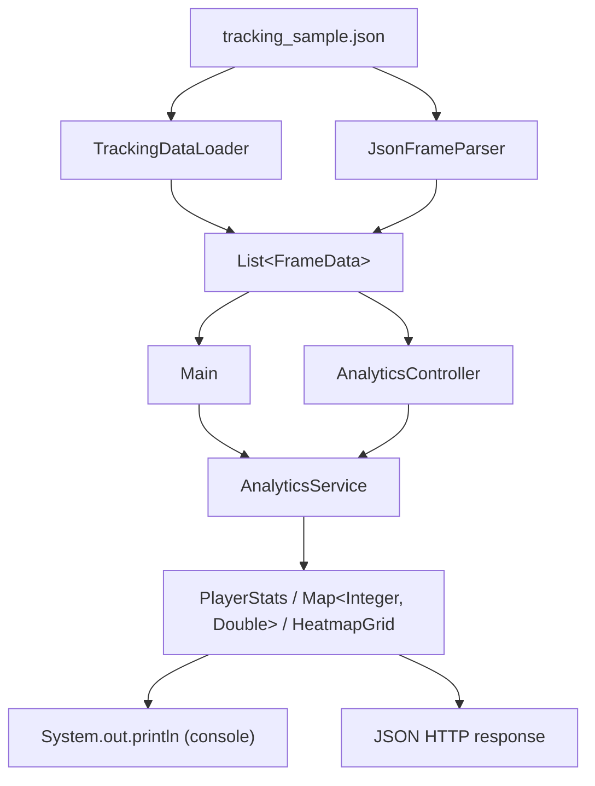
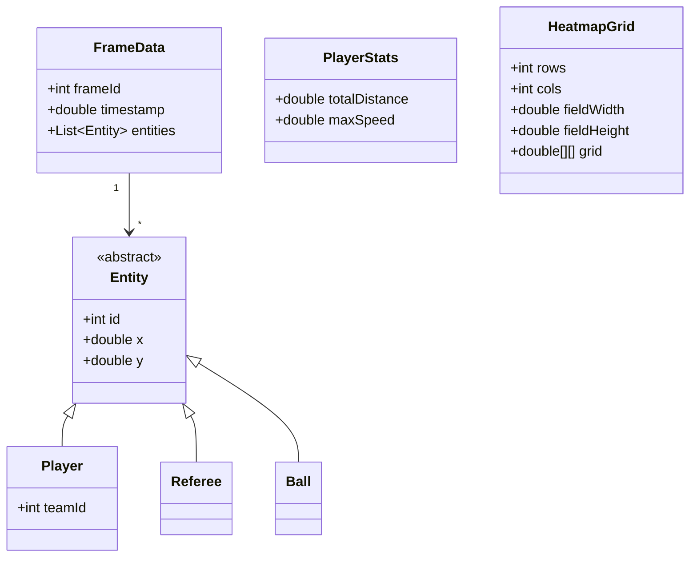

<div align="center">

# ⚽ TaticAnalytics Core

**Tracking data analysis engine for football (soccer) matches**


</div>

## Table of Contents

- [Overview](#overview)
- [Features](#features)
- [Architecture](#architecture)
- [Data Flow](#data-flow)
- [Domain Model](#domain-model)
- [Class Guide](#class-guide)
- [Core API (Java)](#core-api-java)
- [REST API](#rest-api)
- [Input Data](#input-data)
- [Usage](#usage)
- [Running the Project](#running-the-project)
- [Tests](#tests)
- [Algorithms / Implementation Notes](#algorithms--implementation-notes)
- [Known Issues / To Review & Resolve](#known-issues--to-review--resolve)
- [Project Structure](#project-structure)
- [Evolution into a Java Library](#evolution-into-a-java-library)
- [Contributing](#contributing)
- [Roadmap](#roadmap)

---

## Overview

**TaticAnalytics Core** is the Java backend responsible for turning raw tracking data extracted from football match videos into analytical game metrics.

The input data consists of `X, Y` coordinates of players, the referee, and the ball, typically generated by a computer-vision tracking pipeline. The role of this module is to process that data frame by frame and calculate spatial and temporal statistics such as distance covered, maximum speed, ball possession, and spatial heatmaps.

The project has two entry points today:

- A **standalone console application** (`Main`), the original MVP, used for quick verification and batch inspection of tracking data.
- A **Spring Boot REST API** (`Application`), which exposes the same analytics engine (`AnalyticsService`) over HTTP endpoints.

Its internal design separates domain modeling, data loading/parsing, and analytical logic, which makes it a reasonable candidate to evolve into a reusable Java library in the future — and, eventually, to be fed directly by a computer-vision tracking pipeline instead of a static sample file.

---

## Features

### ✅ Implemented

- Loading of tracking data into the domain model, via two parallel paths: `TrackingDataLoader` (tree-based JSON parsing, used by the console app) and `JsonFrameParser` (DTO-based parsing, used by the REST API).
- **Validation of the tracking data on load (TA-76)**: coordinates slightly outside the pitch are clamped, entities far outside it (e.g. in pixel scale) are discarded, required fields are enforced, and the team/ball/id rules of each frame are checked. Both loaders share the same rules. See [Validation on load](#validation-on-load-ta-76).
- Calculation of **total distance covered** by a player.
- Calculation of **maximum speed** reached by a player.
- Calculation of **ball possession per team**, with protection against retroactive attribution and handling of occlusion/contested ball.
- Calculation of **ball possession per player**, using the same possession state machine.
- **Spatial heatmap generation** per player (`HeatmapGrid`), with configurable grid resolution and field dimensions.
- **Strategy pattern in the analytics (TA-77)**: each algorithm (distance/speed, possession, heatmap) lives in its own class behind the `MetricCalculationStrategy<T>` interface, and `AnalyticsService` only delegates to them. See [Design pattern: Strategy](#design-pattern-strategy-ta-77).
- A **Spring Boot REST API** (`AnalyticsController`) exposing player stats, possession (per player/team), and heatmap endpoints.
- **Global exception handling** (`GlobalExceptionHandler`) returning standardized JSON error responses instead of raw stack traces.
- **CORS configuration** (`WebConfig`) allowing cross-origin requests to the API.
- An **export service** (`ExportService`, a Spring `@Service`) able to write results to JSON and CSV files. The console app uses it to export the stats of every player to CSV when an output path is passed as an argument (see [Running the Project](#running-the-project)); it is not exposed through the REST API yet.

### 📋 Planned

See [Roadmap](#roadmap).

---

## Architecture

```text
                    Tracking JSON (tracking_sample.json)
                                 │
                 ┌───────────────┴───────────────┐
                 ▼                                ▼
        TrackingDataLoader                 JsonFrameParser
        (tree-based, console)          (DTO-based, REST API)
                 │                                │
                 └───────────────┬───────────────┘
                                 ▼
                Domain Model (FrameData, Entity, Player, Referee, Ball)
                                 │
                                 ▼
                  AnalyticsService (facade, delegates to strategies)
                                 │
                 ┌───────────────┼───────────────┐
                 ▼               ▼               ▼
          PlayerStats     Possession maps   HeatmapGrid
                 │               │               │
                 ▼               ▼               ▼
        Main (console print)          AnalyticsController (JSON over HTTP)
```

- **`model`** — domain entities representing the state of the field at a given moment, plus output objects (`PlayerStats`, `HeatmapGrid`).
- **`service`** — `AnalyticsService`, the facade that exposes the analytics, and the console-oriented data loader.
- **`service.strategy`** — the analytics algorithms themselves (kinematic calculations, possession state machine, heatmap generation), one class per algorithm behind a common interface (TA-77).
- **`io`** — the DTO-based JSON parser used by the REST API (`JsonFrameParser`, `io.dto.*`) and the export service (`ExportService`).
- **`controller`** — the REST API surface (`AnalyticsController`).
- **`config`** — Spring web configuration (`WebConfig`, CORS).
- **`exception`** — centralized error handling (`GlobalExceptionHandler`).
- **`util`** — shared constants (`MatchConstants`).
- **root (`Main`, `Application`)** — the two entry points: console app and Spring Boot web app.

`AnalyticsService` operates entirely on domain objects and has no dependency on how the tracking data was loaded — this is what allows two different loaders (`TrackingDataLoader` and `JsonFrameParser`) to coexist today.

### Design pattern: Strategy (TA-77)

Before TA-77, `AnalyticsService` held every algorithm (about 250 lines), including two almost identical copies of the possession logic (one keyed by player id, one keyed by team id). Each algorithm now lives in its own class in `service.strategy`, all implementing the same interface, and `AnalyticsService` only packs the inputs into a `MetricParams` and delegates.

```text
  AnalyticsService ───uses──▶ MetricCalculationStrategy<T>
  (facade, same public API)    T calculate(List<FrameData> frames, MetricParams params)
                                        ▲                 ▲                  ▲
                                        │                 │                  │
                            DistanceSpeedStrategy  PossessionStrategy   HeatmapStrategy
                            T = PlayerStats        T = Map<Integer,     T = HeatmapGrid
                                                       Double>
                                                   perPlayer() / perTeam()
```

- **One interface, three result types:** the generic `<T>` lets the same contract return a `PlayerStats`, a `Map<Integer, Double>` or a `HeatmapGrid`.
- **`MetricParams`** (a Parameter Object, implemented as a `record`) carries every possible input (entity id, radius, grid size, field size). Static factories (`forPlayer`, `forPossession`, `forHeatmap`) fill the fields a metric does not use with neutral defaults.
- **No duplication in the possession logic:** `PossessionStrategy` receives a `Function<Player, Integer>` that extracts the key under which the time is credited. `perPlayer()` passes `Player::getId` and `perTeam()` passes `Player::getTeamId`; the algorithm is the same.
- **Same public API:** the methods of `AnalyticsService` keep their names and parameters, and `new AnalyticsService()` still works (it builds the default strategies). A second constructor accepts other strategies, so an algorithm can be replaced without changing `AnalyticsService`.

---

## Data Flow



In plain terms: the tracking file is read either by `TrackingDataLoader.loadData(...)` (console path) or `JsonFrameParser` (REST API path, currently always reading the same sample file via `loadSampleData()`), both producing a list of `FrameData` objects populated with domain entities (`Player`, `Referee`, `Ball`). From there, `Main` or `AnalyticsController` passes this list to `AnalyticsService`, which runs the kinematic algorithms, the ball-possession state machine, and heatmap generation, producing results that are either printed to the console or serialized to JSON and returned over HTTP.

---

## Domain Model



- **`Entity`** *(abstract)* — base contract for any physical object on the field: an identifier (`id`) and coordinates (`x`, `y`).
- **`Player`** *(extends `Entity`)* — represents an athlete on the field; adds a `teamId` attribute associating the player with a team.
- **`Referee`** *(extends `Entity`)* — represents the match referee. Handled explicitly by `Main`.
- **`Ball`** *(extends `Entity`)* — represents the ball; used to identify ball-related entities during possession calculations.
- **`FrameData`** — represents the state of the field at a single instant `T`: a `frameId`, a `timestamp`, and the list of `Entity` objects present in that frame (exposed as a read-only view).
- **`PlayerStats`** — output object encapsulating the kinematic results calculated for a player, exposing `getTotalDistance()`, `getMaxSpeed()`, and `getMaxSpeedKmh()`.
- **`HeatmapGrid`** — output object encapsulating a spatial grid of accumulated time-on-cell values for a player, exposing `getGrid()` (a deep copy), `getRows()`, and `getCols()`.

---

## Class Guide

### `AnalyticsService`

**Package:** `com.taticanalytics.service`

**Responsibility:** the entry point of the analytical engine. Since TA-77 it no longer contains the algorithms: it packs the inputs into a `MetricParams` and delegates to the strategies in `service.strategy` (distance/speed, ball-possession attribution, spatial heatmaps). Stateless (safe as a Spring singleton).

**Main methods:** `calculatePlayerStats(...)`, `calculatePossessionTimePerTeam(...)`, `calculatePossessionTimePerPlayer(...)`, `generatePlayerHeatmap(...)`.

**Relationships:** consumes `List<FrameData>` produced by either `TrackingDataLoader` or `JsonFrameParser`; delegates to `DistanceSpeedStrategy`, `PossessionStrategy` (twice: per player and per team) and `HeatmapStrategy`; consumed by `Main` and `AnalyticsController`. It has a no-arg constructor (default strategies) and a constructor that receives the strategies.

**Role in the architecture:** main candidate to become the public facade should the project evolve into a library.

### `MetricCalculationStrategy<T>` / `MetricParams` (TA-77)

**Package:** `com.taticanalytics.service.strategy`

**Responsibility:** `MetricCalculationStrategy<T>` is the common contract of the analytics algorithms: `T calculate(List<FrameData> frames, MetricParams params)`. `MetricParams` is the `record` that carries every possible input (entity id, possession radius, grid rows/cols, field width/height), with the factories `forPlayer`, `forPossession` and `forHeatmap`.

**Relationships:** implemented by the three strategies below; used by `AnalyticsService`; `MetricParams` takes its defaults from `MatchConstants`.

### `DistanceSpeedStrategy` / `PossessionStrategy` / `HeatmapStrategy` (TA-77)

**Package:** `com.taticanalytics.service.strategy`

**Responsibility:** the algorithms that used to live inside `AnalyticsService`. `DistanceSpeedStrategy` returns a `PlayerStats` (total distance and maximum speed). `PossessionStrategy` returns the possession time per key; `PossessionStrategy.perPlayer()` and `PossessionStrategy.perTeam()` differ only in the function that extracts the key. `HeatmapStrategy` returns a `HeatmapGrid`.

**Relationships:** consume `List<FrameData>` and distinguish `Player` and `Ball`; chosen and called by `AnalyticsService`.

### `TrackingDataLoader`

**Package:** `com.taticanalytics.service`

**Responsibility:** loads tracking data from a file into the domain model by walking the raw JSON tree (`JsonNode`). Used exclusively by the console app. If the file is missing or malformed, it logs the error (SLF4J) and throws `TrackingDataLoadException` instead of returning an empty list. Per-frame progress is logged at `DEBUG` level, and unknown entity types are logged as warnings. Every entity goes through the coordinate and frame checks described in [Validation on load](#validation-on-load-ta-76); a missing required field (`type`, `id`, `x`, `y`, and `team_id` for players) rejects the file with a `TrackingDataLoadException` that names the field and the frame.

**Main methods:** `loadData(String filePath)`, `loadFromClasspath(String resourceName)`, `loadSampleData()`.

**Relationships:** produces `List<FrameData>`; consumed by `Main`; throws `TrackingDataLoadException`.

### `JsonFrameParser`

**Package:** `com.taticanalytics.io`

**Responsibility:** loads tracking data via Jackson DTO deserialization (`EntityDTO`, `FrameDataDTO`) and maps it into the domain model. Used exclusively by the REST API. A Spring `@Component`. It applies the same validation as `TrackingDataLoader` (see [Validation on load](#validation-on-load-ta-76)); a missing required field is reported with an `IOException` that names the field and the frame.

**Main methods:** `parseJsonString(String jsonContent)`, `loadFromClasspath(String resourceName)`, `loadSampleData()`.

**Relationships:** produces `List<FrameData>`; consumed by `AnalyticsController`.

### `EntityDTO` / `FrameDataDTO`

**Package:** `com.taticanalytics.io.dto`

**Responsibility:** "dumb" Java `record`s that mirror the raw JSON shape, used as an intermediate deserialization target before being mapped into the "smart" domain model by `JsonFrameParser`. `id`, `x` and `y` are wrapper types (`Integer`, `Double`) on purpose (TA-76): a field missing from the JSON becomes `null` and can be rejected, whereas a primitive would have silently become `0`.

### `CoordinateStatus` / `CoordinateValidator` (TA-76)

**Package:** `com.taticanalytics.validation`

**Responsibility:** `CoordinateStatus` is an enum with the three possible answers for a position: `INSIDE`, `WITHIN_MARGIN` and `OUT_OF_RANGE`. `CoordinateValidator` is a stateless utility class that answers the question: `classify(x, y)` says in which zone a point is (`NaN` counts as out of range) and `clamp(value, max)` pushes a value into `[0, max]`. It only classifies; what to do with each answer is decided by the caller.

**Relationships:** uses `MatchConstants` (`FIELD_LENGTH`, `FIELD_WIDTH`, `COORDINATE_MARGIN`); used by `CoordinateSanitizer`.

### `CoordinateSanitizer` (TA-76)

**Package:** `com.taticanalytics.validation`

**Responsibility:** applies the coordinate policy to every entity reading of ONE tracking file (keep, clamp, or discard) and counts what it did. At the end of the load it logs one summary line and, if more than `COORDINATE_ALERT_RATIO` (5%) of the readings needed correction, an extra alert. It holds counters, so it is NOT a Spring bean: each loader creates a new one per file.

**Main methods:** `sanitize(int entityId, double x, double y)` (returns an `Optional<Position>`, empty when the entity must be discarded), `logSummary()`, `getCorrectedRatio()`.

**Relationships:** used by `TrackingDataLoader` and `JsonFrameParser`; uses `CoordinateValidator`.

### `FrameIntegrityChecker` (TA-76)

**Package:** `com.taticanalytics.validation`

**Responsibility:** checks the structure of the entities of each frame: a player's `team_id` must be 1 or 2, there is at most one ball per frame, and ids are unique across players, ball and referees. An entity that breaks a rule is discarded with a `WARN` (the first one wins), and the frame is kept. Like the sanitizer, it holds state (the ids already seen in the current frame), so each loader creates a new one per file.

**Main methods:** `startFrame()` (must be called at the start of every frame), `accept(int frameId, Entity entity)`, `logSummary()`.

**Relationships:** used by `TrackingDataLoader` and `JsonFrameParser`.

### `ExportService`

**Package:** `com.taticanalytics.io`

**Responsibility:** exports arbitrary data (stats, heatmaps) to JSON and CSV files on disk. It is a Spring bean (`@Service`) and is used by `Main`, which builds one row per player (`playerId`, `teamId`, `totalDistance`, `maxSpeed`) and calls `exportPlayerStatsToCsv`. The output path is always a parameter, never a constant inside the class, and missing parent folders are created automatically. It is not called from the REST API yet.

**Main methods:** `exportToJson(T data, String filePath)`, `exportPlayerStatsToCsv(...)`, `exportHeatmapToCsv(...)`.

### `AnalyticsController`

**Package:** `com.taticanalytics.controller`

**Responsibility:** exposes `AnalyticsService`'s capabilities as a REST API under `/api/v1/analytics`. See [REST API](#rest-api) for the endpoint list.

**Relationships:** depends on `AnalyticsService` and `JsonFrameParser` via constructor injection.

### `WebConfig`

**Package:** `com.taticanalytics.config`

**Responsibility:** configures CORS for the `/api/**` routes, currently allowing all origins.

### `GlobalExceptionHandler`

**Package:** `com.taticanalytics.exception`

**Responsibility:** intercepts exceptions thrown by any `@RestController` and converts them into standardized JSON error responses (400 for bad parameters/business-rule violations, 500 as a generic catch-all).

### `TrackingDataLoadException`

**Package:** `com.taticanalytics.exception`

**Responsibility:** unchecked exception (`extends RuntimeException`) thrown by `TrackingDataLoader.loadData` when the tracking file is missing or malformed. Carries the file path in its message and the original `IOException` as its cause.

**Relationships:** thrown by `TrackingDataLoader`; caught by `Main`, which prints a friendly message and exits with code `1`. It does not reach the REST API, since the API uses `JsonFrameParser`.

### `Entity` *(abstract)*

**Package:** `com.taticanalytics.model`

**Responsibility:** base contract guaranteeing that every physical object on the field has an identifier and coordinates.

**Relationships:** superclass of `Player`, `Referee`, and `Ball`; aggregated by `FrameData`.

### `Player` *(extends `Entity`)*

**Package:** `com.taticanalytics.model`

**Responsibility:** represents an athlete on the field; adds `teamId`.

**Relationships:** used by `AnalyticsService` in distance, speed, and possession calculations.

### `Referee` *(extends `Entity`)*

**Package:** `com.taticanalytics.model`

**Responsibility:** represents the match referee.

**Relationships:** handled explicitly by `Main`.

### `Ball` *(extends `Entity`)*

**Package:** `com.taticanalytics.model`

**Responsibility:** represents the ball on the field.

**Relationships:** used by `AnalyticsService` in the possession logic.

### `FrameData`

**Package:** `com.taticanalytics.model`

**Responsibility:** groups all objects on the field at a single instant `T`.

**Encapsulation (TA-73):** `getEntities()` returns a read-only view of the internal list, so `add`, `remove` and `clear` on it throw `UnsupportedOperationException`. The only way to add an entity is `addEntity(Entity)`. The protection is shallow: the entities inside the list can still be changed through their own methods.

**Relationships:** contains `Entity` objects; consumed by `AnalyticsService` and produced by `TrackingDataLoader` / `JsonFrameParser`.

### `PlayerStats`

**Package:** `com.taticanalytics.model`

**Responsibility:** output object encapsulating a player's kinematic results.

**Main methods:** `getTotalDistance()`, `getMaxSpeed()`, `getMaxSpeedKmh()`.

**Relationships:** produced by `AnalyticsService`; consumed by `Main` and `AnalyticsController`.

### `HeatmapGrid`

**Package:** `com.taticanalytics.model`

**Responsibility:** output object encapsulating a spatial grid of accumulated time per cell for a player.

**Main methods:** `addTime(double x, double y, double deltaTime)`, `getGrid()`, `getRows()`, `getCols()`.

**Encapsulation (TA-73):** `getGrid()` returns a deep copy of the matrix (each row is copied; a plain `grid.clone()` would be a shallow copy that still shares the rows), so changing the returned matrix never changes the heatmap. The copy is made on every call, which is irrelevant for the default 10x15 grid.

**Edge behavior (TA-76):** a position exactly on the far edge of the pitch (`x = 105.0` or `y = 68.0`) is valid and counts in the last column/row; before, its index was one past the end and the time was silently dropped. A position outside the pitch (including `NaN`) is ignored; before, a small negative value such as `x = -0.5` was wrongly counted in column 0 because casting to `int` truncates toward zero.

**Relationships:** produced by `AnalyticsService`; consumed by `Main` and `AnalyticsController`.

### `MatchConstants`

**Package:** `com.taticanalytics.util`

**Responsibility:** central holder for fixed configuration values (field dimensions, possession radius, default heatmap grid resolution, and, since TA-76, the coordinate tolerance `COORDINATE_MARGIN` and the alert threshold `COORDINATE_ALERT_RATIO`), avoiding magic numbers scattered through the business logic.

### `Main`

**Package:** `com.taticanalytics` (root)

**Responsibility:** entry point of the console application; orchestrates loading via `TrackingDataLoader` and processing via `AnalyticsService`, printing the results (raw frames, kinematic stats, possession, heatmap). If an output path is passed as the first command-line argument, it also exports the stats of every player to that CSV file through `ExportService`; without arguments it only prints to the console. If the tracking file cannot be loaded, it prints a clear message to `System.err` and exits with code `1` instead of reporting empty results.

### `Application`

**Package:** `com.taticanalytics` (root)

**Responsibility:** entry point of the Spring Boot web application; bootstraps the embedded server and the whole `@RestController` / `@Service` / `@Component` ecosystem.

---

## Core API (Java)

### `AnalyticsService`

| Method | Returns | Description |
| --- | --- | --- |
| `calculatePlayerStats(List<FrameData> frames, int entityId)` | `PlayerStats` | Calculates total distance covered and maximum speed for the given entity across the provided frames. |
| `calculatePossessionTimePerTeam(List<FrameData> frames, double radiusMeters)` | `Map<Integer, Double>` | Calculates ball possession time (in seconds) per `teamId`. |
| `calculatePossessionTimePerPlayer(List<FrameData> frames, double radiusMeters)` | `Map<Integer, Double>` | Calculates ball possession time (in seconds) per `playerId`. |
| `generatePlayerHeatmap(List<FrameData> frames, int entityId, int rows, int cols, double fieldWidth, double fieldHeight)` | `HeatmapGrid` | Generates a spatial time-on-cell heatmap for the given entity, with custom grid resolution and field dimensions. |

Overloaded variants of `calculatePossessionTimePerTeam`, `calculatePossessionTimePerPlayer`, and `generatePlayerHeatmap` exist that fall back to `MatchConstants` defaults.

`new AnalyticsService()` uses the default strategies. A second constructor, `AnalyticsService(distanceSpeedStrategy, playerPossessionStrategy, teamPossessionStrategy, heatmapStrategy)`, accepts other implementations of `MetricCalculationStrategy` (TA-77).

### `PlayerStats`

| Method | Returns | Description |
| --- | --- | --- |
| `getTotalDistance()` | `double` | Total distance covered by the player. |
| `getMaxSpeed()` | `double` | Maximum speed reached by the player. |
| `getMaxSpeedKmh()` | `double` | Maximum speed reached by the player, expressed in km/h. |

### `HeatmapGrid`

| Method | Returns | Description |
| --- | --- | --- |
| `getGrid()` | `double[][]` | A deep copy of the accumulated time-per-cell matrix. Changing it does not change the heatmap. |
| `getRows()` | `int` | Number of grid rows. |
| `getCols()` | `int` | Number of grid columns. |

### `TrackingDataLoader`

| Method | Returns | Description |
| --- | --- | --- |
| `loadData(String filePath)` | `List<FrameData>` | Loads tracking data from the given file path into the domain model. Throws `TrackingDataLoadException` (unchecked) if the file is missing or malformed. |
| `loadFromClasspath(String resourceName)` | `List<FrameData>` | Loads a tracking file bundled in the application (classpath resource, name relative to `src/main/resources`). Throws `TrackingDataLoadException` with a clear message if the resource does not exist. |
| `loadSampleData()` | `List<FrameData>` | Convenience method that loads the bundled `tracking_sample.json` from the classpath. |

### `JsonFrameParser`

| Method | Returns | Description |
| --- | --- | --- |
| `parseJsonString(String jsonContent)` | `List<FrameData>` | Deserializes a JSON string into DTOs, then maps it into the domain model. |
| `loadFromClasspath(String resourceName)` | `List<FrameData>` | Reads a bundled classpath resource and parses it. Throws `FileNotFoundException` with a clear message if the resource does not exist. |
| `loadSampleData()` | `List<FrameData>` | Convenience method that loads and parses the bundled `tracking_sample.json` from the classpath. |

---

## REST API

Base path: `/api/v1/analytics`. All endpoints currently operate on the sample dataset (`tracking_sample.json`) loaded via `JsonFrameParser.loadSampleData()` — there is no way yet to submit a different match/tracking file through the API.

| Method | Path | Query Params | Description |
| --- | --- | --- | --- |
| `GET` | `/player/{id}/stats` | — | Returns `PlayerStats` (distance, max speed) for the given player `id`. |
| `GET` | `/possession/players` | `radius` *(optional)* | Returns possession time per player (`Map<Integer, Double>`). Falls back to `MatchConstants.BALL_CONTROL_RADIUS` if `radius` is omitted. |
| `GET` | `/possession/teams` | `radius` *(optional)* | Returns possession time per team (`Map<Integer, Double>`). Same fallback behavior. |
| `GET` | `/player/{id}/heatmap` | `rows`, `cols`, `fieldWidth`, `fieldHeight` *(all optional)* | Returns a `HeatmapGrid` for the given player `id`. Falls back to `MatchConstants` defaults for any omitted parameter. |

**Player ids only (TA-107).** The `{id}` in `/player/{id}/stats` and `/player/{id}/heatmap` always refers to a `Player`. The ball (always id `0`) and the referee also have ids, but they are never matched: asking for their id behaves exactly like asking for a player that does not exist, returning a zero-valued result (`PlayerStats` with `0.0`, or an empty heatmap) with `200 OK` instead of a `404`. A `404` for unknown ids may be reconsidered once the endpoint that lists the match's players (TA-74) and the parameter validation (TA-68) are in place.

Errors are returned as standardized JSON via `GlobalExceptionHandler`:

- `400 Bad Request` — invalid parameter type (e.g. non-numeric `id`) or a thrown `IllegalArgumentException`.
- `500 Internal Server Error` — any other unexpected exception (generic message only, no stack trace leaked to the client).

CORS is open to all origins (`WebConfig`), so any front-end can call this API during development.

---

## Input Data

The project includes a sample tracking dataset at `src/main/resources/tracking_sample.json`, which is loaded through either `TrackingDataLoader` (console) or `JsonFrameParser` (REST API). The sample is read **from the classpath** (resource name `tracking_sample.json`, with no `src/main/resources/` prefix), so it loads the same way from the IDE, from `mvn` and from a packaged `.jar` run in any directory. To load an external file instead (for example a real match), use `TrackingDataLoader.loadData(String filePath)`.

The exact structure of the tracking file (field names, entity typing, etc.) is defined by this dataset and by the loader/DTO implementations. Refer to `tracking_sample.json`, `EntityDTO`, and `FrameDataDTO` directly for the authoritative format.

### Coordinate units (TA-43)

`x`/`y` on every entity are **meters** on the pitch (0–105 for `x`, 0–68 for `y`, matching `MatchConstants.FIELD_LENGTH`/`FIELD_WIDTH`), never pixels. An earlier version of `tracking_sample.json` had them in pixel space (e.g. the ball sitting at `x:960.5, y:540.0`, exactly the center of a 1920×1080 frame), which silently broke `HeatmapGrid` — coordinates that large mapped to grid cells far outside its bounds, so the boundary check in `HeatmapGrid.addTime` discarded every update without ever throwing, and the heatmap came back essentially empty. Distance and speed were wrong in the same way, just less visibly (large numbers instead of an obviously-empty result).

`match_info.resolution` (e.g. `{"width": 1920, "height": 1080}`) is kept as legitimate metadata about the **source video** the tracking data was extracted from — it has no relationship to the `x`/`y` scale and is not read by any calculation. Don't use it to infer units.

The sample was also regenerated with 30 frames and 8 players (4 per team, plus the ball and the referee) instead of 2 frames and 3 entities, with a short possession change from one player to another, so it's actually enough to exercise possession switching, a heatmap that spans more than one cell, and a ranking across several players — not just confirm that parsing doesn't crash. Frame-to-frame displacements were kept physically plausible for 30 fps footage (a few m/s of jogging for most players, a single faster stretch of a few m/s more for a firm pass).

### Validation on load (TA-76)

The tracking file comes from computer vision, so it can contain measurement noise or broken values. Both loaders (`TrackingDataLoader` and `JsonFrameParser`) apply the same rules while reading the file, and nothing is corrected or dropped silently: every case is counted and logged.

| Situation | What happens |
|---|---|
| Position inside the pitch (`x` in [0, 105], `y` in [0, 68]) | Kept as it came. |
| Position up to **2 m** outside the pitch (`COORDINATE_MARGIN`) | Treated as measurement noise: **clamped** to the nearest edge and kept. |
| Position more than 2 m outside, or not a number (this includes values in pixel scale, e.g. `x: 960`) | The entity is **discarded** from that frame, with a `WARN`. The frame itself is kept. |
| Missing required field: `type`, `id`, `x`, `y`, or `team_id` on a player | The **whole file is rejected** with a clear message (which field, which frame). The file's producer broke the contract and a value cannot be guessed. |
| Player whose `team_id` is not 1 or 2 | The entity is discarded, with a `WARN`. |
| A second ball in the same frame | The extra ball is discarded, with a `WARN` (the first one wins). |
| An `id` already used by another entity in the same frame | The later entity is discarded, with a `WARN` (the first one wins). |

At the end of each load, one line summarizes how many readings were checked, clamped and discarded. If more than **5%** of the readings needed correction (`COORDINATE_ALERT_RATIO`), an extra alert is logged: that rate is a sign of a systematic problem, such as a wrong camera calibration in the CV pipeline, and not of random noise. To avoid flooding the log, only the first 10 discards are logged one by one; the rest are only counted in the summary.

**Why discard instead of rejecting the file?** The three options considered were rejecting the whole file, discarding only the affected entity, or accepting everything and just logging. Rejecting makes one bad frame ruin a whole match, and accepting everything lets wrong data into the calculations. Discarding the entity (and only that entity) is the middle ground and matches the rule that an absent entity in a frame is acceptable. The exception is a missing required field, which is a broken contract rather than a noisy value.

---

## Usage

### Java (embedding the core directly)

```java
TrackingDataLoader loader = new TrackingDataLoader();
List<FrameData> frames = loader.loadData("tracking_sample.json");

AnalyticsService analytics = new AnalyticsService();

// Kinematic statistics for a specific player
PlayerStats stats = analytics.calculatePlayerStats(frames, /* entityId */ 7);
double distance = stats.getTotalDistance();
double maxSpeedKmh = stats.getMaxSpeedKmh();

// Ball possession per team
Map<Integer, Double> possessionPerTeam =
    analytics.calculatePossessionTimePerTeam(frames, /* radiusMeters */ 2.0);

// Ball possession per player
Map<Integer, Double> possessionPerPlayer =
    analytics.calculatePossessionTimePerPlayer(frames, /* radiusMeters */ 2.0);

// Spatial heatmap for a player
HeatmapGrid heatmap = analytics.generatePlayerHeatmap(frames, /* entityId */ 7);
```

> The `radiusMeters` value above is illustrative; adjust it to match your desired possession-detection tolerance.

### REST API (via HTTP)

```bash
curl http://localhost:8080/api/v1/analytics/player/7/stats
curl http://localhost:8080/api/v1/analytics/possession/players?radius=2.0
curl http://localhost:8080/api/v1/analytics/possession/teams
curl "http://localhost:8080/api/v1/analytics/player/7/heatmap?rows=10&cols=15"
```

---

## Running the Project

**Prerequisites:**

- Java 17+
- Maven

**Build:**

```bash
mvn clean compile
```

**Run the console app:**

```bash
mvn clean compile exec:java -Dexec.mainClass="com.taticanalytics.Main"
```

`Main` loads the sample tracking data via `TrackingDataLoader` and runs the analytics via `AnalyticsService`, printing the results to the console.

**Export the stats of all players to CSV:**

Pass the output path as the first argument. The folder is created if it does not exist.

```bash
mvn clean compile exec:java -Dexec.mainClass="com.taticanalytics.Main" -Dexec.args="output/players.csv"
```

The file has one line per player, ordered by id, with decimal numbers written with a dot regardless of the computer's language settings:

```csv
playerId,teamId,totalDistance,maxSpeed
1,1,3.16539209179255,4.93297593821196
2,1,2.390072848187561,4.342595017715772
```

Distance is in meters and max speed in m/s. If the file cannot be written, `Main` prints a clear message to the error stream and exits with code `1`. The `java_core/output/` folder is ignored by Git.

**Run the REST API:**

```bash
mvn spring-boot:run
```

This starts the embedded Tomcat server (default port `8080`) and exposes the endpoints documented in [REST API](#rest-api).

---

## Tests

```bash
mvn test
```

- `AnalyticsServiceTest` — covers the ball-possession state machine (per team and per player), including protection against retroactive attribution, as well as the kinematic calculations (distance/speed). Since TA-77 these tests go through `AnalyticsService` and therefore also exercise the strategies, unchanged.
- `AnalyticsServiceHeatmapTest` — covers heatmap cell accumulation, frame-gap handling, non-existent players, and default-dimension fallbacks.
- `AnalyticsControllerTest` — covers the REST layer with `@WebMvcTest` and `MockMvc` (service and parser replaced by `@MockBean`): JSON responses for stats, possession (per player/team, with and without `radius`) and heatmap (no parameters, partial parameters with `MatchConstants` fallbacks, all parameters), plus the `400` (invalid `id`) and `500` (sample file cannot be loaded) error responses.
- `JsonFrameParserTest` — covers DTO-based JSON parsing into the domain model and, since TA-76, the same validation rules as `TrackingDataLoader`.
- `ExportServiceTest` — covers `ExportService` being picked up by Spring as a bean and the CSV output (header, rows, decimal dot, header-only file for an empty list, creation of missing parent folders, heatmap grid), all written to a temporary folder (`@TempDir`).
- `FrameDataTest` — covers the encapsulation of `FrameData`: the list returned by `getEntities()` cannot be changed from outside (`UnsupportedOperationException`) and `addEntity` still works.
- `HeatmapGridTest` — covers the encapsulation of `HeatmapGrid`: changing the matrix returned by `getGrid()` does not change the heatmap (deep copy), and, since TA-76, a position on the far edge counts in the last cell while positions outside the pitch are ignored.
- `TrackingDataLoaderTest` — covers the failure paths of `TrackingDataLoader.loadData` (non-existent file and malformed JSON, using `@TempDir`), asserting that `TrackingDataLoadException` is thrown with the file path in the message instead of an empty list being returned. Since TA-76 it also covers the validation on load: clamping, discarding (including pixel-scale coordinates), missing required fields, and the team/ball/id rules.
- `CoordinateValidatorTest` — covers the boundaries of the three coordinate zones (corner of the pitch, exactly 2 m outside, just past 2 m, `NaN`) and `clamp` (TA-76).
- `CoordinateSanitizerTest` — covers keep/clamp/discard, the counters and the share of corrected readings used by the 5% alert (TA-76).
- `FrameIntegrityCheckerTest` — covers the `team_id`, single-ball and unique-id rules, and that the checker forgets its memory when a new frame starts (TA-76).

---

## Algorithms / Implementation Notes

### Distance

The distance covered by an entity is calculated as the sum of the Euclidean distances between its positions in consecutive frames.

### Speed

```text
speed = distance / Δt
```

The maximum speed is updated whenever a higher instantaneous speed is found along the frame series, and is exposed both in its base unit (`getMaxSpeed()`) and in km/h (`getMaxSpeedKmh()`).

### Ball possession

Implemented once, in `PossessionStrategy`; the per-player and per-team results differ only in the key function (`Player::getId` or `Player::getTeamId`). For every frame, the system identifies which player is closest to the ball. If that minimum distance is within the given `radiusMeters`, that player (and their team) is considered the possessor of the ball at that instant.

### Temporal state (avoiding retroactive attribution)

Instead of crediting each time interval to whoever is closest to the ball *in the current frame*, the system keeps track of the current possessor and credits the elapsed time to that previous possessor before updating the state. This avoids retroactively crediting possession time to a player who only gained possession after the interval in question.

### Heatmap

The pitch is divided into a `rows × cols` grid. For each pair of consecutive frames in which the target entity appears, the elapsed time (`Δt`) is credited to the grid cell the entity occupied *during* that interval (i.e. its position in the earlier of the two frames), based on its `(x, y)` coordinates and the configured field dimensions.

### Entity matching (TA-107)

`DistanceSpeedStrategy` and `HeatmapStrategy` find the requested entity with `entity instanceof Player player && player.getId() == entityId`, that is, by **type and id**, never by id alone. Ids are only unique among entities of the same type: a tracker can give a player the same id used by a referee (both in the same frames), and matching by id alone would make the algorithm jump between them and accumulate fake distance (impossible speeds) with no error. The ball and the referee are therefore never returned as if they were a player.

### Frame continuity rule

All three algorithms above (distance/speed, possession, heatmap) only compute a value across two frames when `frame.getFrameId() - previousFrameId == 1`. This avoids treating a gap in tracking (occlusion, dropped frames) as a real, possibly enormous, movement.

---

## Known Issues / To Review & Resolve

This section tracks known gaps and risks identified during an internal code review, to be revisited once the computer-vision tracking pipeline is integrated.

### Independent of the computer-vision pipeline (safe to fix anytime)

- `GlobalExceptionHandler`'s catch-all handler (`Exception.class`) never logs the underlying exception server-side — an unexpected error in production would leave no trace to debug from.
- `AnalyticsController` does not validate `rows`, `cols`, or `radius` query parameters. Invalid values (e.g. negative `rows`) fall into the generic 500 handler instead of a proper `400 Bad Request`.
- `ExportService` is wired into the console app only. Exposing it through the REST API (a download endpoint) would require it to write to a stream instead of a file path, and a way to list the players of the match (see the roadmap).

### Dependent on the computer-vision pipeline (revisit after integration)

- **Duplicate parsing logic**: `TrackingDataLoader` (tree-based, console) and `JsonFrameParser` (DTO-based, REST API) implement the same JSON-to-domain-model mapping independently, and already behave differently on unknown entity types (one logs, the other silently ignores). Once the real data contract from the CV pipeline is defined, these should likely be unified into a single loader. (Since TA-76 both already share the same validation classes, so the validation rules themselves cannot drift apart; only the JSON-to-domain mapping is duplicated.)
- **API bound to the sample file**: every `AnalyticsController` endpoint always loads `tracking_sample.json` — there is no mechanism yet to submit or select a real match's tracking data. This needs to be designed once it's clear how the CV pipeline will deliver data (batch file, stream, upload endpoint, shared storage, etc.).
- **Frame-continuity assumption vs. real tracking gaps**: distance, possession, and heatmap calculations all skip any interval where `frameId` isn't perfectly consecutive. If the CV pipeline drops or de-duplicates low-confidence frames at a different rate than expected, this could silently under-report a large share of the metrics. Worth validating against real CV output before trusting the numbers.
- **CORS fully open** (`allowedOrigins("*")`) — fine for local development against a CV prototype, but should be scoped down once there's a real front-end/consumer.

---

## Project Structure

```text
taticanalytics-core/
├── pom.xml
└── src/
    ├── main/
    │   ├── java/
    │   │   └── com/
    │   │       └── taticanalytics/
    │   │           ├── Application.java
    │   │           ├── Main.java
    │   │           ├── config/
    │   │           │   └── WebConfig.java
    │   │           ├── controller/
    │   │           │   └── AnalyticsController.java
    │   │           ├── exception/
    │   │           │   ├── GlobalExceptionHandler.java
    │   │           │   └── TrackingDataLoadException.java
    │   │           ├── io/
    │   │           │   ├── ExportService.java
    │   │           │   ├── JsonFrameParser.java
    │   │           │   └── dto/
    │   │           │       ├── EntityDTO.java
    │   │           │       └── FrameDataDTO.java
    │   │           ├── model/
    │   │           │   ├── Ball.java
    │   │           │   ├── Entity.java
    │   │           │   ├── FrameData.java
    │   │           │   ├── HeatmapGrid.java
    │   │           │   ├── Player.java
    │   │           │   ├── PlayerStats.java
    │   │           │   └── Referee.java
    │   │           ├── service/
    │   │           │   ├── AnalyticsService.java
    │   │           │   ├── TrackingDataLoader.java
    │   │           │   └── strategy/
    │   │           │       ├── DistanceSpeedStrategy.java
    │   │           │       ├── HeatmapStrategy.java
    │   │           │       ├── MetricCalculationStrategy.java
    │   │           │       ├── MetricParams.java
    │   │           │       └── PossessionStrategy.java
    │   │           ├── util/
    │   │           │   └── MatchConstants.java
    │   │           └── validation/
    │   │               ├── CoordinateSanitizer.java
    │   │               ├── CoordinateStatus.java
    │   │               ├── CoordinateValidator.java
    │   │               └── FrameIntegrityChecker.java
    │   └── resources/
    │       └── tracking_sample.json
    └── test/
        └── java/
            └── com/
                └── taticanalytics/
                    ├── controller/
                    │   └── AnalyticsControllerTest.java
                    ├── io/
                    │   ├── ExportServiceTest.java
                    │   └── JsonFrameParserTest.java
                    ├── model/
                    │   ├── FrameDataTest.java
                    │   └── HeatmapGridTest.java
                    ├── service/
                    │   ├── AnalyticsServiceHeatmapTest.java
                    │   ├── AnalyticsServiceTest.java
                    │   └── TrackingDataLoaderTest.java
                    └── validation/
                        ├── CoordinateSanitizerTest.java
                        ├── CoordinateValidatorTest.java
                        └── FrameIntegrityCheckerTest.java
```

---

## Evolution into a Java Library

`TaticAnalytics Core` is structured so that its evolution into a reusable library is architecturally viable, even though that separation is not implemented as a distinct module today.

```text
        Consuming applications (present & future)
        ┌───────────────┬───────────────┬───────────────┐
        │  Spring Boot   │    JavaFX     │  CV Pipeline   │
        │  (this REST    │   (future)    │  (future data  │
        │   API today)   │               │   source)      │
        └───────┬───────┴───────┬───────┴───────┬───────┘
                │  Analytics API │
                └────────┬───────┘
                          │
                TaticAnalytics Core
        (model + service — domain and business rules)
```

**Why this separation is viable:**

- `AnalyticsService` depends only on domain objects (`FrameData`, `Entity`, `Player`, `Referee`, `Ball`) — it has no knowledge of how the data was loaded.
- This decoupling already allows two different loaders (`TrackingDataLoader`, `JsonFrameParser`) to feed the same engine, and would, in theory, allow feeding `AnalyticsService` with data from other sources in the future (WebSocket, REST API, database, or directly from a computer-vision pipeline), without changing its internal logic.

**Main candidates in an eventual split:**

- **Library core (public):** `AnalyticsService` as the main facade; `model.*` as the exposed domain types.
- **Internal components (non-public):** `Main`, `Application`, `TrackingDataLoader`, and `JsonFrameParser` would move to samples/adapter modules, not part of the public analytics API.

---

## Contributing

Suggested path for anyone contributing to the project:

1. **Start with the models** (`com.taticanalytics.model`) — understand the `Entity` inheritance, the composition of `FrameData`, and the `HeatmapGrid` structure.
2. **Read `AnalyticsService` and the `service.strategy` package** — `AnalyticsService` is the facade and the strategies hold the business logic. Pay special attention to the possession state machine in `PossessionStrategy`, how it avoids retroactive attribution, and the frame-continuity rule shared by distance/possession/heatmap calculations.
3. **Understand data loading** in `TrackingDataLoader` (console path) and `JsonFrameParser` (REST API path) — see how the tracking file becomes a `List<FrameData>`, and note that these two loaders currently duplicate logic (see [Known Issues](#known-issues--to-review--resolve)).
4. **Read `AnalyticsController`** to see how the same engine is exposed over HTTP, and `GlobalExceptionHandler` to see how errors are standardized.
5. **Run `Main`** to see the console end-to-end flow, and `mvn spring-boot:run` to see the REST API end-to-end flow.
6. **Read the test suites** (`AnalyticsServiceTest`, `AnalyticsServiceHeatmapTest`, `JsonFrameParserTest`) to understand the covered edge cases (occlusion, contested ball, retroactive bias, frame gaps, non-existent players/entities).

To run the tests locally:

```bash
mvn test
```

---

## Roadmap

### ✅ Done

- [x] Kinematic calculations (distance, max speed).
- [x] Ball possession per team and per player, with retroactive-attribution protection.
- [x] Heatmap / grid-based spatial metrics.
- [x] Spring Boot REST API exposing the analytics engine.
- [x] Global exception handling with standardized JSON error responses.
- [x] CORS configuration for cross-origin API access.
- [x] Export of the stats of all players to CSV from the console app (`ExportService` as a Spring bean).
- [x] Strategy pattern in the analytics algorithms, removing the duplicated possession logic (TA-77).

### 📋 Planned

- [ ] `GameStatus` filter (ball out of play / half-time).
- [ ] Expose `ExportService` through the REST API (download endpoint with `Content-Disposition`), after the "list players" endpoint exists.
- [ ] Unify `TrackingDataLoader` and `JsonFrameParser` into a single loader, once the computer-vision pipeline's data contract is defined.
- [ ] Allow the REST API to process real match/tracking data instead of only the fixed sample file.
- [ ] Add request-parameter validation (`rows`, `cols`, `radius`) with proper `400` responses.
- [ ] Add server-side logging of unexpected exceptions in `GlobalExceptionHandler`.
- [x] Load bundled resources via classpath instead of relative file paths, to support running as a packaged `.jar`.
- [x] Validate the tracking data on load (coordinate limits, required fields, team/ball/id rules) with a shared policy and a summary log (TA-76).
- [ ] Package the core as a reusable `.jar` library.
- [ ] Evaluate integration with JavaFX as an additional application layer on top of the core.
- [ ] Define and validate the integration contract with the computer-vision tracking pipeline (schema, delivery mechanism, frame-drop handling).
